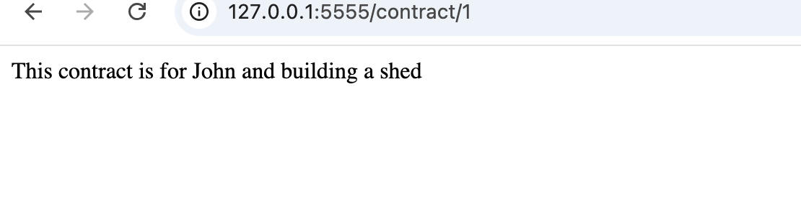

# Python Flask Contracts Lab

A small Flask app for a company that manages contractors between two parties. It has two routes: one for contract information and one for customer information. Customer data is sensitive, so the customer route confirms that a customer exists without returning any of their data.

## Screenshot

## Routes

### `/contract/<id>`

Looks up a contract by its numeric ID in the `contracts` list.

- If the contract is found, it returns the contract information with a 200 response.
- If the contract is not found, it returns a 404 response.

### `/customer/<customer_name>`

Checks whether a customer name is in the `customers` list.

- If the customer is found, it returns an empty body with a 204 response.
- If the customer is not found, it returns a 404 response.

Customer names are lowercase, so `bob` is found and `Bob` is not.

## Setup

1. Create and activate a virtual environment:

       python3 -m venv venv
       source venv/bin/activate

2. Install Flask:

       pip install flask

3. Run the app from the `server` folder:

       cd server
       python3 app.py

The app runs at http://127.0.0.1:5555.

## Trying it out

- http://127.0.0.1:5555/contract/1 returns the contract text (200)
- http://127.0.0.1:5555/contract/99 returns 404
- http://127.0.0.1:5555/customer/bob returns 204 with no content
- http://127.0.0.1:5555/customer/zed returns 404

A 204 response has no body, so the browser stays on the current page. To see the status code, use curl:

    curl -i http://127.0.0.1:5555/customer/bob
